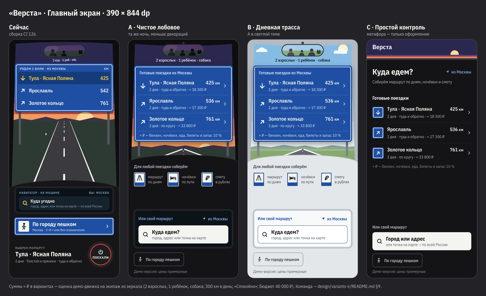
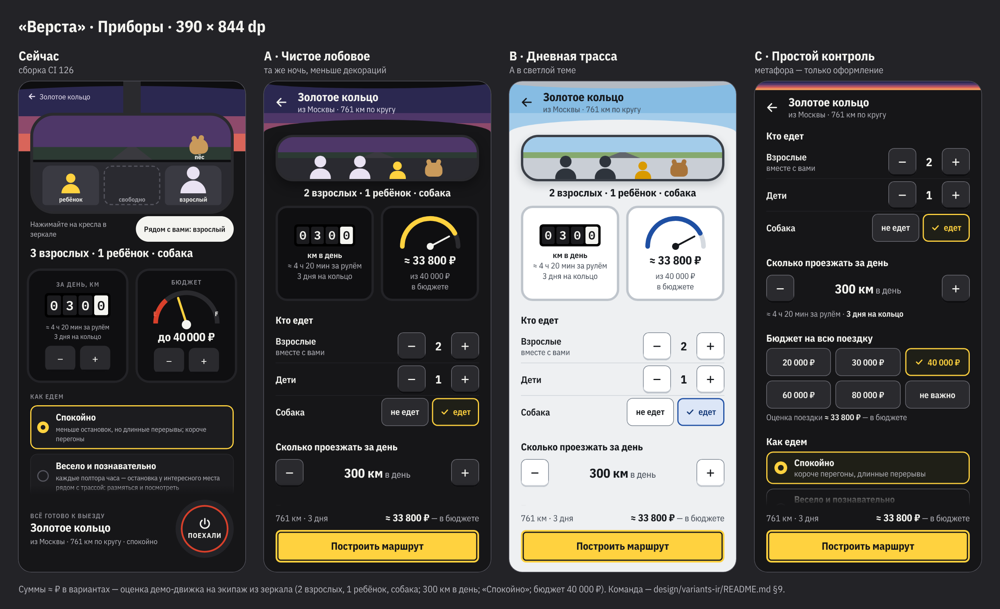

# Варианты главного экрана и «Приборов»: A, B, C

26.10.2026 · Designer · бриф: [`docs/design-review.md`](../../docs/design-review.md), шаг 2 плана

Здесь только макеты. Код приложения, `design/tokens.json` и спецификации экранов не менялись. Заморозка функций до M2 соблюдена: новых функций нет. Есть несколько изменений поведения существующих экранов, они перечислены в §4 и требуют решения.




## 1. Цели из разбора

- Сохранить концепцию «вид из-за руля», синие указатели, зеркало, одометр и бензобак, палитру и шрифты.
- Метафора — это оформление, а не способ управления. Ввод делается обычными кнопками и чипами со словами, приборы показывают итог.
- На главном одно главное действие: ответить на вопрос «Куда едем?» готовой поездкой или своим городом.
- Каждое число объясняет себя: «425 км» и рядом «2 дня · туда и обратно · ≈ 18 300 ₽».
- Проще и крупнее: текст не меньше 14 sp, подписи без капса с разрядкой, касания не меньше 48 dp.
- Варианты нужны для теста 5 секунд (§9). Они отличаются ровно одной переменной:
  - **A ↔ B**: только тема (B собирается из разметки A, см. `tools/build-b.js`);
  - **A ↔ C**: только степень метафоры (тема одна и та же, ночная).

## 2. Что меняет каждый вариант

### A «Чистое лобовое» — та же ночь, меньше декораций

**Главный**
- Лобовое стекло ужато до зеркала, указателя и полосы дороги под ним. Горизонт сразу под указателем, а приборная панель начинается с 410 dp (сейчас с 500).
- На синем указателе три готовые поездки. Каждая строка — кнопка в две строки:
  - первая строка: название и «425 км»;
  - вторая строка: «2 дня · туда и обратно · ≈ 18 300 ₽».
  - Под строками сноска «≈ ₽ — бензин, ночёвки, еда, билеты и запас 10 %» (это и есть строки сметы движка). Шапка без капса: «Готовые поездки из Москвы».
- Нажатие на строку сразу открывает «Приборы» с этой поездкой. Шага «выбрать строку → нажать Поехали» больше нет, поэтому на главном нет ни подписи «Выбран маршрут», ни круглой кнопки.
- Навигатор на панели — «Или свой маршрут»:
  - светлая табличка-поле «Куда едем? — город, адрес или точка на карте»;
  - справа кнопка «из Москвы» (бывшее «ВЫ: МОСКВА»).
- «По городу пешком» стал тихой кнопкой-контуром внизу. Синяя табличка в полную ширину убрана.
- При первом запуске, на экранах высотой от 760 dp, в свободной части панели показана легенда «Для любой поездки соберём». Это три знака сервиса по ГОСТ: «маршрут по дням», «ночёвки по пути», «смету в рублях». Легенда отвечает на вопрос «что это за приложение». После первой сохранённой поездки на её месте появляется «Мои поездки».
- Внизу честная строка «Демо-версия: цены примерные».

**Приборы**
- Сверху итог, который нельзя редактировать:
  - зеркало со всем экипажем и подпись «2 взрослых · 1 ребёнок · собака»;
  - одометр «0300 — км в день, ≈ 4 ч 20 мин за рулём, 3 дня на кольцо»;
  - бензобак: дуга заполнена на долю оценки от бюджета, «≈ 33 800 ₽ из 40 000 ₽ — в бюджете». Латинских E/F больше нет.
- Ниже обычные элементы управления:
  - «Кто едет»: степперы «Взрослые (вместе с вами)» и «Дети», переключатель «Собака: не едет / едет»;
  - «Сколько проезжать за день»: «− 300 км в день +», шаг 50, диапазон 150–900, как сейчас;
  - «Бюджет на всю поездку»: шесть чипов с прежними пресетами;
  - «Как едем»: три карточки с короткими пояснениями, выбрано «Спокойно» (с ним посчитаны суммы, §9);
  - «Машина и выезд».
- Подсказка «Нажимайте на кресла в зеркале» не нужна и убрана.
- Внизу закреплены строка итога «761 км · 3 дня · ≈ 33 800 ₽ — в бюджете» и единственная главная кнопка «Построить маршрут». Это жёлтая табличка временного знака с тёмной внутренней рамкой, как у указателей. Значка ⏻ и красного кольца нет.

### B «Дневная трасса» — A при дневном свете

- Разметка и тексты такие же, как в A. Отличаются только цвета (`tokens-day.json`):
  - дневное небо в пять полос, высокое бледное солнце и два плоских облака;
  - зелёные поля и серый асфальт;
  - светло-серая пластиковая панель и светлый экран навигатора.
- Синий указатель тот же, по ГОСТ: на светлом фоне он читается даже сильнее, чем ночью.
- Жёлтый цвет на светлом фоне не используется ни для текста, ни для тонких линий. На светлом жёлтая только главная кнопка: это заливка с тёмной рамкой 2 dp, рамка и даёт контраст границы 3:1.
- Выбор, фокус и стрелка спидометра на светлом — синие (`chip.selected*`, `focus`).
- Колодцы приборов белые. Одометр остаётся тёмным: он механический и днём выглядит так же.

### C «Простой контроль» — метафора только как бренд

**Главный**
- Сверху полоса-логотип: «Верста» на закатных полосах с солнцем.
- Дальше обычная колонка:
  - заголовок «Куда едем?» и кнопка «из Москвы»;
  - обещание «Соберём маршрут по дням, ночёвки и смету»;
  - список «Готовые поездки». Указатель стал оформлением строк: у каждой синяя табличка со стрелкой направления, а строки те же, что в A.
- Поле «Или свой маршрут» стоит внизу, в зоне большого пальца, как «Куда?» у Яндекс Go. Самый быстрый путь — готовая поездка прямо под вопросом.

**Приборы**
- Простая форма без зеркала, одометра и бензобака:
  - производные числа стоят под тем элементом, от которого зависят: «≈ 4 ч 20 мин за рулём · 3 дня на кольцо», «Оценка поездки ≈ 33 800 ₽ — в бюджете»;
  - снизу та же закреплённая кнопка.
- На 390×844 без прокрутки видны экипаж, км в день и бюджет. Путь до первого маршрута: строка на главном → «Построить маршрут», 2 нажатия.

## 3. Какие проблемы разбора решает каждый вариант

✓ — решено, ◐ — частично, ✗ — не решено (честно).

| № | Проблема | A | B | C |
| --- | --- | --- | --- | --- |
| 1 | Декорации съедают экран | ✓ на 390×844: пустого пейзажа 124 тыс. → 46 тыс. dp², **−63 %** (было 37,7 % экрана, стало 14 %). ◐ на 360×640: −13 %, потому что указатель вырос ради строк смысла, а остаток высоты отдан полосе дороги, а не пустой панели. Высота сцены 500 → 410 dp (−18 %): указатель — это содержимое, а не декорация | как A | ✓ сцена — полоса 72 dp, пейзажа 0 |
| 2 | Четыре равных призыва | ✓ одно действие: ответ на «Куда едем?» (строка указателя или поле). «Поехали» на главном нет, пешеходный режим — тихая кнопка внизу | ✓ | ✓ |
| 3 | «Поехали» похожа на выключение | ✓ ⏻ и красного кольца нет, кнопка «Построить маршрут» говорит, что произойдёт. ◐ та же круглая кнопка есть ещё на «Навигаторе» (5.2), он вне задачи; предложение — в §8 | ✓ / ◐ | ✓ / ◐ |
| 4 | Метафоры как способ управления | ✓ ввод — степперы и чипы со словами; зеркало, одометр и бак показывают только итог | ✓ | ✓ (метафор нет) |
| 5 | «Дорога впереди» перегружена | ✗ экран вне задачи. На этих двух экранах убраны капс с разрядкой и текст мельче 14 sp; так же стоит сделать и там | ✗ | ✗ |
| 6 | Числа без смысла | ✓ «425 км» + «2 дня · туда и обратно · ≈ 18 300 ₽» + сноска о составе суммы; одометр подписан часами и днями; бак — оценка относительно бюджета | ✓ | ✓ |
| 7 | Только тёмная тема | ✗ | ✓ | ✗ (палитру B можно наложить и на C) |
| 8 | Рукописный шрифт в формулах | ✗ «Путевой лист» вне задачи | ✗ | ✗ |

## 4. Что меняется в поведении (нужно решение, без него переход невозможен)

1. **Строка готовой поездки сразу открывает «Приборы».** Сейчас по SPEC 5.1 нажатие только выбирает строку, а дальше нужно «ПОЕХАЛИ». Шагов становится на один меньше, и с главного уходит круглая кнопка.
2. **«≈ N ₽» в каждой строке указателя.** Данные уже есть: оценка поездки `estimate.totalRub`, её сейчас показывают «Приборы» (Sprint 3). Но на главном её нужно запрашивать для 3–4 строк, а не только для выбранной.
   - Пока оценка не пришла, в строке «≈ … ₽», как сейчас для км.
   - Без сети — сумма из кэша или строка без суммы.
3. **Экипаж задаётся счётчиками, а не креслами.** Рассадка по местам пропадает, но движок её и не использует: он получает `adults`, `children`, `dog`.
   - Пределы прежние (OI-07): взрослых и детей вместе не больше 8, взрослых не меньше 1. У предела кнопка «+» неактивна, подсказка «В машине до 8 человек вместе с вами».
   - «Рядом с вами» входит в число взрослых.
4. **Бензобак показывает оценку относительно бюджета**, а не позицию пресета. Бюджет выбирается чипом.
5. **Тексты «Как едем» сокращены до одной строки.** Пресеты и их значения в движке не меняются.
6. **Строка «Демо-версия: цены примерные»** на главном. Это подпись к демо-данным: в демо-сборке её требует правило «content must be honest».

## 5. Что остаётся как есть

- Палитра ночи, шрифты Verst Sans Narrow и IBM Plex Mono, синий указатель (рамка 2 dp, радиусы 9/6), стрелки по азимуту в 8 направлений, знаки сервиса.
- Километры — оценка движка, а не шаблона (5.1 §3), а также формулы «≈ X ч Y мин» (км / 70 × 60, с округлением до 10 мин) и «N дней на кольцо».
- Пресеты бюджета, диапазон 150–900 км, пресеты «Как едем», лист «Машина и выезд», сохранение значений как умолчаний.
- Анимации A/B из `motion.md`: полосы, столбы, покачивание зеркала, хвост собаки. В макетах показан кадр 0. В C анимаций нет.
- Офлайн-состояния, загрузка, «нет готовых маршрутов», ошибка — по 5.1 §4 с новыми строками.
- API, движок и «Путевой лист» не затронуты.

## 6. Новые токены и правила

Все значения в HTML — переменные из `shared/base.css`. Каждой соответствует токен из `design/tokens.json` (ночь) или из `tokens-day.json` (день). Если вариант выберут, в генератор токенов нужно добавить:

| Токен | Значение | Зачем |
| --- | --- | --- |
| `color.chip.border` (ночь) | #707078 | контур клавиш, чипов и тихих кнопок, 3,68:1 на `dash.raised` (сейчас #3A3A42 даёт 1,6:1) |
| `color.chip.selectedFill` (ночь) | #1F1F17 | уже есть в MoodCard (components §25), выносится в токен |
| `colorDay.*` | `tokens-day.json` | вся тема B, те же имена ролей |
| `size.touchMin` | 48 (было 44) | все кнопки, клавиши и чипы ≥ 48 dp |
| `type.sign.meta` | 14/18, 400, `sign.blueText` | строка смысла на указателе |
| `type.section` | 17/22, 700 | заголовки разделов «Кто едет» и др. вместо капса 11 sp |
| `type.label` | 15/20, 600, без капса и разрядки | подписи вроде «Или свой маршрут» |
| `type.body.min` | 14 sp | ниже 14 sp текста нет нигде на этих экранах |
| `component.ctaPlate` | h ≥ 56, отступ 3, внутренняя рамка 2 dp `text.onLight`, радиусы 9/6, `type.cta.lg` 18/700 | главная кнопка в языке указателей (жёлтый временный знак) |

## 7. Контраст (WCAG 2.2 AA)

Проверено скриптом `tools/contrast.py`: 52 пары, все проходят. Текст — 4,5:1, крупный текст и границы элементов (1.4.11) — 3:1.

| Тема | Цвет | Фон | Где | Нужно | Есть |
| --- | --- | --- | --- | --- | --- |
| A, C (ночь) | `text.primary` #F4F4F0 | `dash.base` #141416 | основной текст на приборной панели | 4.5 | **16.69** |
| A, C (ночь) | `text.secondary` #B9B9C0 | `dash.base` #141416 | вторичный текст 14–15 sp | 4.5 | **9.43** |
| A, C (ночь) | `text.secondary` #B9B9C0 | `dash.raised` #161618 | вторичный текст на «Приборах» | 4.5 | **9.26** |
| A, C (ночь) | `text.muted` #8C8C93 | `dash.raised` #161618 | подписи 14 sp | 4.5 | **5.41** |
| A, C (ночь) | `text.primary` #F4F4F0 | `dash.controlAlt` #2A2A2E | цифра степпера / текст чипа | 4.5 | **12.96** |
| A, C (ночь) | `accent.yellow` #FFD23F | `chip.selectedFill` #1F1F17 | выбранный чип: текст | 4.5 | **11.48** |
| A, C (ночь) | `text.onLight` #141416 | `accent.yellow` #FFD23F | главная кнопка «Построить маршрут» | 4.5 | **12.74** |
| A, C (ночь) | `sign.white` #F4F4F0 | `sign.blue` #1E4FA3 | название на синем указателе | 4.5 | **7.05** |
| A, C (ночь) | `sign.blueText` #D6E0F5 | `sign.blue` #1E4FA3 | строка смысла на указателе 14 sp | 4.5 | **5.86** |
| A, C (ночь) | `accent.yellow` #FFD23F | `sign.blueSelected` #163B7A | нажатая строка указателя | 4.5 | **7.49** |
| A, C (ночь) | `text.onLight` #141416 | `sign.white` #F4F4F0 | поле «Куда едем?» | 4.5 | **16.69** |
| A, C (ночь) | `text.onLightMuted` #55565C | `sign.white` #F4F4F0 | подсказка в поле | 4.5 | **6.63** |
| A, C (ночь) | `navi.label` #7FA6D9 | `navi.screen` #0B1218 | «из Москвы» на экране навигатора (A) | 4.5 | **7.50** |
| A, C (ночь) | `navi.label` #7FA6D9 | `dash.base` #141416 | «из Москвы» рядом с заголовком (C) | 4.5 | **7.32** |
| A, C (ночь) | `sign.white` #F4F4F0 | `sign.blue` #1E4FA3 | стрелка на табличке-иконке списка (C) | 3.0 | **7.05** |
| A, C (ночь) | `mirror.label` #E9E2F2 | `sky.band1` #2B2850 | подпись экипажа под зеркалом | 4.5 | **10.92** |
| A, C (ночь) | `mirror.label` #E9E2F2 | `sky.band2` #4E3768 | «Назад» и подзаголовок на небе (Приборы) | 4.5 | **8.03** |
| A, C (ночь) | `text.primary` #F4F4F0 | `dash.well` #0F0F11 | значение в колодце прибора | 4.5 | **17.37** |
| A, C (ночь) | `text.secondary` #B9B9C0 | `dash.well` #0F0F11 | подпись в колодце прибора | 4.5 | **9.81** |
| A, C (ночь) | `accent.yellow` #FFD23F | `dash.raised` #161618 | рамка выбранного чипа | 3.0 | **12.51** |
| A, C (ночь) | `chip.border` #707078 | `dash.raised` #161618 | рамка чипов и клавиш (новый токен) | 3.0 | **3.68** |
| A, C (ночь) | `chip.border` #707078 | `dash.base` #141416 | контур «По городу пешком» | 3.0 | **3.75** |
| A, C (ночь) | `accent.yellow` #FFD23F | `dash.raised` #161618 | кольцо фокуса | 3.0 | **12.51** |
| B (день) | `text.primary` #15181C | `dash.base` #E4E7EA | основной текст на панели | 4.5 | **14.35** |
| B (день) | `text.secondary` #3D4550 | `dash.base` #E4E7EA | вторичный текст, «По городу пешком» | 4.5 | **7.81** |
| B (день) | `text.primary` #15181C | `dash.raised` #EEF0F2 | основной текст на «Приборах» | 4.5 | **15.59** |
| B (день) | `text.secondary` #3D4550 | `dash.raised` #EEF0F2 | вторичный текст на «Приборах» | 4.5 | **8.49** |
| B (день) | `text.muted` #545D69 | `dash.raised` #EEF0F2 | подписи 14 sp | 4.5 | **5.84** |
| B (день) | `text.muted` #545D69 | `dash.base` #E4E7EA | строка «Демо-версия» | 4.5 | **5.38** |
| B (день) | `text.primary` #15181C | `key.fill` #FFFFFF | цифра степпера / текст чипа | 4.5 | **17.81** |
| B (день) | `chip.selectedText` #163B7A | `chip.selectedFill` #DCE6F7 | выбранный чип: текст | 4.5 | **8.61** |
| B (день) | `text.onCta` #15181C | `cta.fill` #FFD23F | главная кнопка | 4.5 | **12.33** |
| B (день) | `sign.white` #F4F4F0 | `sign.blue` #1E4FA3 | название на указателе | 4.5 | **7.05** |
| B (день) | `sign.blueText` #D6E0F5 | `sign.blue` #1E4FA3 | строка смысла на указателе | 4.5 | **5.86** |
| B (день) | `accent.yellowOnSign` #FFD23F | `sign.blueSelected` #163B7A | нажатая строка указателя | 4.5 | **7.49** |
| B (день) | `navi.text` #15181C | `navi.field` #FFFFFF | поле «Куда едем?» | 4.5 | **17.81** |
| B (день) | `navi.hint` #4F5B68 | `navi.field` #FFFFFF | подсказка в поле | 4.5 | **6.93** |
| B (день) | `navi.label` #1E4FA3 | `navi.screen` #F7F9FB | «из Москвы» на экране навигатора | 4.5 | **7.36** |
| B (день) | `mirror.label` #15181C | `sky.band1` #86BCE3 | подпись экипажа под зеркалом | 4.5 | **8.75** |
| B (день) | `text.primary` #15181C | `sky.band1` #86BCE3 | «Назад» и заголовок на небе | 4.5 | **8.75** |
| B (день) | `text.secondary` #3D4550 | `sky.band1` #86BCE3 | подзаголовок «из Москвы · 761 км» на небе | 4.5 | **4.76** |
| B (день) | `text.secondary` #3D4550 | `sky.band2` #A3CCEA | подзаголовок на нижней полосе неба | 4.5 | **5.72** |
| B (день) | `text.primary` #15181C | `well.fill` #FFFFFF | значение в колодце прибора | 4.5 | **17.81** |
| B (день) | `text.secondary` #3D4550 | `well.fill` #FFFFFF | подпись в колодце прибора | 4.5 | **9.70** |
| B (день) | `link` #1E4FA3 | `dash.base` #E4E7EA | текстовая ссылка (токен на будущее) | 4.5 | **6.26** |
| B (день) | `key.border` #6F7A87 | `dash.base` #E4E7EA | контур «По городу пешком» | 3.0 | **3.52** |
| B (день) | `navi.fieldBorder` #6E7A88 | `navi.screen` #F7F9FB | граница поля | 3.0 | **4.14** |
| B (день) | `chip.selectedBorder` #1E4FA3 | `dash.raised` #EEF0F2 | рамка выбранного чипа | 3.0 | **6.80** |
| B (день) | `key.border` #6F7A87 | `dash.raised` #EEF0F2 | граница кнопок и чипов | 3.0 | **3.82** |
| B (день) | `cta.border` #15181C | `dash.base` #E4E7EA | контур главной кнопки на светлом | 3.0 | **14.35** |
| B (день) | `focus` #1E4FA3 | `dash.raised` #EEF0F2 | кольцо фокуса | 3.0 | **6.80** |
| B (день) | `focus` #1E4FA3 | `dash.base` #E4E7EA | кольцо фокуса на панели | 3.0 | **6.26** |

Самая слабая пара — 4,76:1, подзаголовок «из Москвы · 761 км» на дневном небе. Запас небольшой, поэтому при доработке неба B этот цвет фона нужно сохранить или затемнить.

## 8. Риски

- **Бренд.** Круглая кнопка «ПОЕХАЛИ» запоминалась. Слово «Поехали» предлагаю оставить заголовком экрана «Строим дорогу» (Drive), а с кнопок убрать. У C самый высокий риск «похоже на любое приложение»: отличие держится только на полосе-логотипе и табличках.
- **Навигатор (5.2)** по-прежнему с круглой «ПОЕХАЛИ». Проблему 3 нужно закрыть и там: та же жёлтая табличка «Дальше: кто едет».
- **Оценки на главном** — до четырёх запросов оценки при запуске (см. §4.2). Если не успевают, строки показывают «≈ … ₽».
- **Свободное место на 390×844.**
  - В A/B его занимает легенда первого запуска, а после первой поездки — «Мои поездки».
  - В C это спокойный промежуток между готовыми поездками и полем.
  - Тест покажет, не выглядит ли это пустотой.
- **B — новая иллюстрация неба.** Для перехода нужно отрисовать дневные варианты остальных экранов, иначе тема будет неполной. Список экранов: «Дорога впереди», «Съезд к ночёвке» (ночью логичнее оставить ночь), «Путевой лист».
- **Демо-цифры.** Суммы ≈ ₽ в макетах — оценка демо-движка на экипаж из зеркала (§9), но цены в демо-сборке примерные, а гостиницы вымышленные. На экране это сказано строкой «Демо-версия: цены примерные».
- **Тула дороже Ярославля при меньшем пробеге** (18 300 и 17 300 ₽). Это честный результат движка: в смете Тулы есть билеты в усадьбу и музеи (3 000 ₽), у Ярославля билетов нет, а еды больше. В тесте вопрос 3 спрашивает именно про Ярославль, но такая разница может вызвать вопросы; ответ — в строках сметы на «Путевом листе».

## 9. Откуда цифры

Все три готовые поездки посчитаны настоящим движком (`backend/planner`, мир `central_russia_v1`) с **одинаковыми** входными данными: тот экипаж, что в зеркале, и те значения, что на «Приборах».

- Старт — Москва.
- Экипаж — 2 взрослых, 1 ребёнок, собака.
- 300 км в день, «Спокойно» (`calm`), бюджет 40 000 ₽.
- Машина по умолчанию: АИ-95, 8,0 л на 100 км.
- Выезд в субботу 07.11.2026 в 08:00, часы движка — эталонные (`2026-10-23T09:00+03:00`).
- Меняется только `readyRouteId`.

| Строка | Значение на экране | Вывод движка |
| --- | --- | --- |
| Тула · Ясная Поляна | 425 км · 2 дня · туда и обратно · ≈ 18 300 ₽ | `km` 425, `days` 2, `nights` 1, `roundTrip` true, `cost.totalRub` 18 300 (бензин 2 100, платные 0, ночёвки 5 500, еда 6 000, билеты 3 000, запас 1 660), `overBudget` false |
| Ярославль | 536 км · 2 дня · туда и обратно · ≈ 17 300 ₽ | `km` 536, `days` 2, `nights` 1, `roundTrip` true, `cost.totalRub` 17 300 (бензин 2 650, платные 0, ночёвки 6 000, еда 7 050, билеты 0, запас 1 570), `overBudget` false |
| Золотое кольцо | 761 км · 3 дня · по кругу · ≈ 33 800 ₽; «Приборы»: «≈ 33 800 ₽ из 40 000 ₽ — в бюджете» | `km` 761, `days` 3, `nights` 2, `roundTrip` true, `cost.totalRub` 33 800 (бензин 3 760, платные 0, ночёвки 12 000, еда 11 250, билеты 3 700, запас 3 070), `overBudget` false |
| «≈ 4 ч 20 мин за рулём», «3 дня на кольцо» | 300 км / 70 км/ч с округлением до 10 мин; ⌈761 / 300⌉ | `RuFormat.driveMinutes`, правило 5.3 §3 |

Ярославль — **536 км**, а не 542, как в текущей сборке. 542 — это эталон `G01`, то есть свободная поездка A → B, а не готовый маршрут `rr_yaroslavl`. Сборка показывает 542, потому что фикстура скриншот-теста берёт км из G01. Это несоответствие стоит передать разработчику.

Входной файл (для Тулы; для двух других меняется только `readyRouteId`: `rr_yaroslavl`, `rr_golden_ring`):

```json
{"input": {"origin": {"lat": 55.7558, "lon": 37.6173, "label": "Москва"}, "readyRouteId": "rr_tula_yasnaya",
  "crew": {"adults": 2, "children": 1, "dog": true}, "dailyKm": 300, "mood": "calm", "budget": 40000,
  "startAt": "2026-11-07T08:00"}, "clock": "2026-10-23T09:00:00+03:00"}
```

Команда. Входные файлы лежат вне репозитория, эталоны не тронуты:

```
cd backend/planner
python3 -m verst_planner.cli plan --world fixtures/worlds/central_russia_v1.json --input <файл>.json
```

Три готовые поездки — столько их в фикстуре сборки (`ScreensScreenshotTest.routes`).

## 10. Рекомендация

**Взять A за основу и подключить палитру B как светлую тему по системной настройке Android. Не выбирать между A и B.** Причины:

- **A закрывает 1, 2, 3, 4 и 6, не теряя то, что разбор велит сохранить:** указатель, зеркало, одометр, бензобак, дорогу.
- **Решение сохраняет вывод разбора:** бренд — плюс, мешало только управление.
- **B стоит дёшево и закрывает проблему 7.** Это та же разметка с другими токенами. Тест решит только, нужна ли светлая тема по умолчанию.
- **C — запасной вариант.** Он нужен, если в тесте 5 секунд A заметно проиграет C по вопросу «что нажать первым». Тогда метафора всё-таки мешает, и честнее сделать её оформлением. Сейчас этого не видно.

## 11. Тест 5 секунд (для UX Specialist и Growth Marketer)

- **Схема.** 20 человек, у каждого один вариант главного экрана; варианты распределяются поровну (A/B/C ≈ 7/7/6).
  - Экран показывается 5 секунд на телефоне или в натуральном размере (PNG 390×844).
  - Потом экран закрывается и задаются вопросы.
  - Затем то же самое для «Приборов».
  - В конце человек видит все три варианта рядом (`compare-*.png`) в случайном порядке и выбирает предпочтение.

**Главный, после 5 секунд:**

1. «Для чего это приложение?» Засчитывается: «спланировать поездку на машине» с упоминанием маршрута, ночёвок или стоимости.
2. «Что бы вы нажали первым, чтобы поехать куда-нибудь на выходные?» Засчитывается: готовая поездка или поле «Куда едем?». Отдельно отметить, называют ли пешеходный режим.
3. «Сколько примерно стоит поездка в Ярославль? Это в одну сторону или туда и обратно?» Ожидается ≈ 17 300 ₽, туда и обратно. Проверяется проблема 6.
4. Клик-тест на той же картинке без лимита времени: «Покажите, куда нажать, чтобы выбрать Тулу». Засчитывается: строка Тулы.

**Приборы, после 5 секунд:**

5. «Сколько человек едет и едет ли собака?» Ожидается: двое взрослых, ребёнок, собака.
6. «Укладывается ли поездка в бюджет?» Ожидается: да, ≈ 33 800 из 40 000.
7. «Что произойдёт, если нажать жёлтую кнопку?» Засчитывается: построится маршрут. Не засчитывается: «выключится», «поедем сразу».

**Сравнение:** «На каком экране вы бы спланировали поездку и почему?» Записать дословно.

**Порог.** Вариант считается понятным, если на вопросы 1–3 и 5–7 правильно отвечают не меньше 70 % участников этого варианта. При разнице меньше 2 человек между A и C выбираем A, потому что он сохраняет бренд.

## 12. Файлы и как пересобрать

```
design/variants-ir/
  a/windshield.html, a/instruments.html     — вариант A (источник и для B)
  b/*.html                                  — сгенерированы из A: node design/variants-ir/tools/build-b.js
  c/windshield.html, c/instruments.html     — вариант C
  shared/base.css                           — токены ночь/день как CSS-переменные, компоненты; шрифты берутся из android/core-ui/src/main/res/font (OFL)
  shared/scene.js                           — кадр сцены лобового стекла (A/B)
  png/<вариант>-<экран>-<w>x<h>.png         — 12 снимков, 2×
  compare-windshield.png, compare-instruments.png — сейчас vs A vs B vs C
  tokens-day.json                           — цвета темы B
  tools/render.js, compare.js, contrast.py  — рендер (Playwright), сравнение, проверка контраста
```

Из корня репозитория:

```
node design/variants-ir/tools/build-b.js
node design/variants-ir/tools/render.js      # печатает проверки: шрифты, горизонтальный выход, касания < 48, текст < 14 sp, обрезка
node design/variants-ir/tools/compare.js     # нужен origin/ci-logs (скриншоты сборки CI 126)
python3 -I design/variants-ir/tools/contrast.py
```

Последний прогон: все 12 снимков без замечаний (`ok`), контраст 52/52.
